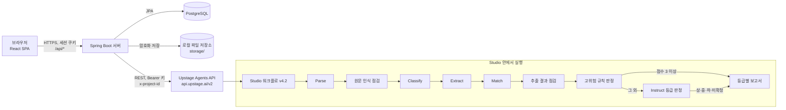

# 아키텍처

- 프로젝트명: IM-BANK
- 최종 수정일: 2026-11-09
- 상태: draft

요구사항은 [PRD](./PRD.md)에 있습니다. 이 문서는 그 요구사항을 어떤 구성으로 구현하는지 설명합니다.

## 1. 시스템 구성도

- 브라우저는 Spring Boot 서버하고만 통신합니다. Upstage API 키는 브라우저에 절대 전달하지 않습니다.
- 판정은 Studio 워크플로 안에서 끝납니다. 서버는 파일을 전달하고, 결과를 해석해 저장하고, 권한에 맞게 보여 줍니다.
- 배포할 때는 React 빌드 결과를 Spring Boot의 정적 파일로 넣어 서버 하나로 실행합니다. 개발할 때만 Vite 개발 서버(5173)와 Spring Boot(8080)를 따로 띄우고 Vite 프록시로 `/api`를 넘깁니다.

## 2. 기술 스택과 선택 근거

| 영역 | 선택 | 근거 |
|---|---|---|
| 백엔드 | Java 21, Spring Boot 3.5.7, Gradle 8.14 wrapper | 사용자가 다른 프로젝트(`Personalized-Recommendation-Prog`)에서 같은 버전으로 구현해 본 스택입니다. 금융권 심사위원에게도 익숙합니다. |
| 보안 | Spring Security 6 (세션 쿠키 + CSRF) | 같은 출처의 SPA이므로 JWT보다 세션이 단순하고, 토큰 탈취 위험을 줄입니다. 근거는 [보안](./SECURITY.md) 2장 |
| DB | PostgreSQL 16, Flyway, Spring Data JPA | JSONB로 좌표·단계 정보를 저장하고, Flyway로 스키마 이력을 관리합니다. |
| HTTP 클라이언트 | Spring `RestClient` | Upstage API는 OpenAI 호환 REST이므로 SDK 없이 multipart 업로드와 JSON 호출로 충분합니다. |
| 프런트엔드 | React 19, Vite, TypeScript(strict), React Router | 단일 페이지 앱으로 업로드·진행·결과 화면을 전환합니다. |
| UI | Tailwind CSS, shadcn/ui | 별도 디자인 없이 정돈된 화면을 빠르게 만들 수 있습니다. |
| 서버 상태 | TanStack Query | 분석 상태 조회(폴링)와 캐시를 간단히 처리합니다. |
| 문서 표시 | PDF.js (`react-pdf`) | 페이지를 캔버스로 그리고 그 위에 좌표 상자를 겹칩니다. |
| 테스트 | JUnit 5, Spring Security Test, Testcontainers 1.21.4, Vitest, Testing Library | Testcontainers는 이 PC의 Docker 29와 통신하려면 1.21.4 이상이어야 합니다. |

> ⚠️ 가정: 가린 PDF 다운로드(P2)는 Java의 PDFBox로 구현하기 어렵습니다. 이 기능을 P0로 올리면 Python 작업기(PyMuPDF)를 따로 두는 방안을 다시 검토합니다.

## 3. 주요 컴포넌트와 책임

### 백엔드 (`server/`, 패키지 `com.imbank.docguard`)

| 패키지 | 책임 |
|---|---|
| `auth` | 회원가입, 로그인·로그아웃, 비밀번호 정책, 로그인 실패 잠금, 현재 사용자 조회 |
| `user` | 사용자와 역할, 관리자용 계정 관리 |
| `analysis` | 업로드 검증, 원본 저장, 분석 작업 생성, 상태 전이, 목록·상세 조회 |
| `studio` | Upstage Agents API 클라이언트(`StudioClient`)와 응답 변환(`StudioResultMapper`). Studio 응답 형식은 이 패키지 밖으로 새지 않습니다. |
| `studio.poller` | 진행 중인 작업을 주기적으로 조회하는 스케줄러 |
| `result` | 보고서 파싱(등급·사람 검토·항목별 문단·인용), 발견 항목과 좌표 정리, 표시용 가림 처리 |
| `review` | 검토 대기열, 검토 결정 기록 |
| `audit` | 감사 기록 저장과 조회 |
| `storage` | 원본 파일과 결과의 암호화 저장·삭제(AES-256-GCM), 보관 기간 정리 |
| `common` | 오류 응답 형식, 요청 ID, 설정 속성 |

### 프런트엔드 (`web/`)

| 폴더 | 책임 |
|---|---|
| `src/pages` | 화면 단위 컴포넌트 (목록은 [유저 플로우](./USER_FLOW.md) 2장) |
| `src/features/analysis` | 업로드, 진행 표시, 결과 요약 |
| `src/features/viewer` | PDF 페이지 렌더링과 좌표 상자 겹치기, 가림·원문 보기 전환 |
| `src/features/report` | 보고서 항목 표시, 인용 링크와 문서 위치 연결 |
| `src/features/review` | 검토 대기열, 검토 입력 |
| `src/features/admin` | 계정 관리, 감사 기록 |
| `src/api` | `fetch` 래퍼(CSRF 헤더, 오류 처리)와 API 타입 |

## 4. 외부 연동: Upstage Agents API

2026-11-06에 `studio/api_probe.py`로 실제 호출을 확인했습니다. 응답 구조의 실측 결과는 Studio 버전 안내의 "API 호출 시험" 절에 있습니다.

### 호출 순서

| 순서 | 요청 | 비고 |
|---|---|---|
| 1 | `POST /v2/files` (multipart: `file`, `purpose=user_data`) | 응답의 `id`(예: `file_...`)를 저장 |
| 2 | `POST /v2/responses` `{model, config_id, include:["last"], input:[{role:"user", content:[{type:"input_file", file_id}]}]}` | 응답의 `id`(작업 ID)와 `status` 저장 |
| 3 | `GET /v2/responses/{job_id}?include[]=all` 를 3초마다 | `queued`, `in_progress`, `completed`, `failed` |
| 4 | `DELETE /v2/files/{file_id}` | 작업이 끝나면 성공·실패와 관계없이 실행 |

모든 요청에 `Authorization: Bearer ${UPSTAGE_API_KEY}`와 `x-project-id: ${UPSTAGE_PROJECT_ID}`를 붙입니다.

### 응답에서 쓰는 값

결과는 `output[]`에 단계별로 들어 있고, `output[].model`이 단계 이름입니다. `text`와 `additional_values`는 모두 **문자열로 된 JSON**이므로 한 번 더 파싱합니다.

| 단계 이름 | 꺼내는 값 |
|---|---|
| `step_1_parse` | 페이지 수, `cache_hit` |
| `Validate - 원문 인식 점검` | `additional_values.verdict` |
| `step_2_classify` | `additional_values.document_type._value`, `confidence_score` |
| `Information Extract - 공통민감정보 추출` | `text`의 `민감정보 발견내역[]`, `additional_values`의 필드별 `page`, `coordinates`, `word_coordinates`, `confidence`, `잔존 정보` |
| `Match - 공식근거 정책 대조` | 항목별 정책 연결 여부 |
| `Validate - 추출 결과 점검` | `additional_values.verdict` |
| `Validate - 고위험 규칙 판정` | `additional_values.verdict`. green이면 판정 경로를 규칙으로, 그 외에는 AI 판정으로 저장 |
| `Instruct - 등급 판정` | 읽지 않음. 보고서가 아니며 등급은 보고서에서만 읽습니다(BR01) |
| `Instruct - 민감정보 분석보고서 {상·중·하·미확정}` | `text`(JSON 문자열을 한 번 더 풀어야 하는 보고서 본문), `additional_values.citations[]`. 등급별 노드 중 실행된 하나만 응답에 있습니다 |

- 단계 이름은 Studio 노드 이름에서 만들어지므로, 서버는 이름을 설정 파일(`studio.steps.*`)에 두고 코드에 박아 두지 않습니다. 이름으로 찾지 못하면 내용(`민감정보 발견내역` 키, 보고서 제목)으로 한 번 더 찾습니다.
- Extract와 Match 단계가 모두 `민감정보 발견내역`을 돌려주므로 Extract 단계의 값을 씁니다.
- 좌표는 0~1 사이 상대값입니다. 화면은 페이지의 너비와 높이를 곱해 그립니다.
- 보고서의 【†n】은 `citations[n-1]`과 연결되며, `source_ref`(예: `민감정보 발견내역[0].원문값`)로 발견 항목을 가리킵니다.

### 보고서 해석 규칙

- `^위험 등급: (잠정\s*)?(상|중|하|미확정|노출 없음)` 줄에서 등급을 읽습니다. `미확정`은 읽기 실패(`UNKNOWN`)와 구분해 `UNDECIDED`로 저장합니다. `잠정`과 `노출 없음`은 v3.2에서 폐기되었고, v2.5 보고서를 읽기 위해서만 남겨 둡니다.
- `^사람 검토: (필요|불필요)` 줄에서 사람 검토 여부를 읽습니다.
- 항목 제목(`요약`, `발견된 문제`, `판정 근거`, `정책 연결 상태`, `적용한 공식 근거`, `활용 맥락`, `추가 확인 및 조치`, `점검 범위`)으로 문단을 나눕니다. 같은 제목이 반복되면 문단을 나온 순서대로 줄바꿈으로 잇습니다. 화면에 줄 때 저장 원문에서 다시 읽으므로 이미 저장된 결과에도 적용됩니다.
- 보고서 문단과 사람 검토 사유를 화면에 줄 때 미마스킹→가림 없음, 부분마스킹→일부 가림, 전체마스킹→전체 가림으로 바꿉니다. 저장된 원문과 【†n】 표시는 그대로 둡니다.
- **어느 줄이든 읽지 못하면** 등급을 `UNKNOWN`으로 두고 사람 검토를 필요로 표시합니다. 서버가 등급을 추측하지 않습니다.
- 이 규칙은 `eval/compare.py`의 `parse_report`와 같습니다. 서버 단위 테스트는 v2.5 보고서 10건(`eval/answer_key.json`)과 v3.2 보고서 20건(`eval/answer_key_v3.json`)으로 같은 결과가 나오는지 확인합니다.

## 5. 서버 API 초안

"검토 범위"는 검토 대기 중이거나 그 검토자가 검토한 분석입니다([보안](./SECURITY.md) 1장). 모든 경로는 `/api` 아래에 있고, 응답은 JSON입니다. 오류는 `{ "code": "...", "message": "...", "requestId": "..." }` 형식을 씁니다.

| 메서드와 경로 | 권한 | 설명 |
|---|---|---|
| `GET /api/auth/csrf` | 모두 | CSRF 토큰 쿠키 발급 |
| `POST /api/auth/signup` | 비로그인 | 가입. 역할은 항상 `INSPECTOR` |
| `POST /api/auth/login` · `POST /api/auth/logout` | 모두 | 세션 로그인·로그아웃 |
| `GET /api/auth/me` | 로그인 | 현재 사용자와 역할 |
| `POST /api/analyses` | `INSPECTOR`, `REVIEWER`, `ADMIN` | 파일 업로드, `202 Accepted`와 분석 ID |
| `GET /api/analyses` | `INSPECTOR`, `REVIEWER`, `ADMIN` | 내 분석 목록 |
| `GET /api/analyses/{id}` | 소유자, 검토 범위의 `REVIEWER`, `ADMIN` | 상태, 진행 단계, 요약 |
| `GET /api/analyses/{id}/result` | 소유자, 검토 범위의 `REVIEWER`, `ADMIN` | 보고서, 가린 발견 항목, 좌표, 인용 |
| `GET /api/analyses/{id}/file` | 소유자, 검토 범위의 `REVIEWER`, `ADMIN` | 원본 파일 (복호화해서 전달, 캐시 금지) |
| `POST /api/analyses/{id}/reveal` | 소유자, 검토 범위의 `REVIEWER`, `ADMIN` | 원문값 열람. 사유 필수, 감사 기록 |
| `POST /api/analyses/{id}/retry` | 소유자, `ADMIN` | 실패한 분석 다시 실행 |
| `DELETE /api/analyses/{id}` | 소유자, `ADMIN` | 원본과 결과 즉시 삭제 |
| `GET /api/reviews/queue` | `REVIEWER`, `ADMIN` | 검토 대기 목록 |
| `POST /api/analyses/{id}/review` | `REVIEWER`, `ADMIN` | 확인 완료 또는 이의, 사유 |
| `GET /api/admin/users` · `PATCH /api/admin/users/{id}` | `ADMIN` | 계정 목록, 역할·상태 변경 |
| `GET /api/admin/audit-logs` | `ADMIN` | 감사 기록 조회 |
| `GET /api/admin/analyses` | `ADMIN` | 모든 사용자의 분석 목록 (파일 이름, 올린 사람 포함) |
| `GET /actuator/health` | 모두 | 상태 확인 (그 밖의 actuator는 닫음) |

## 6. 배포와 인프라 구성

### 로컬 개발 (현재 범위)

| 구성 | 포트 | 실행 |
|---|---|---|
| PostgreSQL 16 (Docker Compose) | 5434 | `docker compose up -d` |
| Spring Boot | 8080 | `server/gradlew bootRun` |
| Vite 개발 서버 | 5173 | `web/npm run dev` (`/api`를 8080으로 프록시) |

- 다른 프로젝트가 5432(Personalized-Recommendation-Prog), 5433(Gyeongbug-Expedition)을 쓰므로 5434를 씁니다.
- 원본 파일 저장소는 `storage/`(저장소 밖, `.gitignore`)입니다.

### 시연과 배포 (추후)

- 시연은 노트북에서 `server/gradlew bootJar`로 만든 jar 하나와 Docker PostgreSQL로 실행합니다. 프런트엔드 빌드는 jar 안에 들어갑니다.
- 외부 배포는 네이버클라우드 Ubuntu 서버 한 대에 합니다(2026-11-08 사용자 결정). Caddy가 HTTPS(`sslip.io` 주소, Let's Encrypt)를 맡고, jar 하나가 화면과 API를 함께 제공하며(`SpaResourceConfig`), PostgreSQL 16은 같은 서버에 설치합니다. 절차는 `deploy/README.md`에 있습니다.

## 7. 환경 변수

값은 저장소에 두지 않습니다. `scripts/create-env`가 로컬 `.env`를 만들고, 비밀 값은 무작위로 생성하거나 사용자가 직접 입력합니다.

| 이름 | 예시·기본값 | 비밀 | 설명 |
|---|---|---|---|
| `UPSTAGE_API_KEY` | 사용자가 입력 | 예 | Upstage 콘솔에서 만든 키 (`up_...`) |
| `UPSTAGE_PROJECT_ID` | 사용자가 입력 | 아니요 | 워크플로가 속한 Project ID. 저장소에는 적지 않음 |
| `UPSTAGE_AGENT_ID` | 사용자가 입력 | 아니요 | 호출할 워크플로 Agent ID. v4.2는 v4.2를 불러온 워크플로의 값 |
| `UPSTAGE_CONFIG_ID` | 코드 기본값 `2`(과거 기록용) | 아니요 | 반드시 호출할 워크플로의 설정 번호로 지정합니다. Agent ID와 짝이 맞아야 합니다 |
| `UPSTAGE_BASE_URL` | `https://api.upstage.ai/v2` | 아니요 | |
| `UPSTAGE_POLL_INTERVAL_MS` | `3000` | 아니요 | 상태 조회 간격 |
| `UPSTAGE_JOB_TIMEOUT_SEC` | `600` | 아니요 | 기다리는 시간의 최솟값. 쪽수 × 60초가 더 크면 그 시간까지 기다리고, 넘으면 실패 처리 |
| `DB_URL` · `DB_USERNAME` | `jdbc:postgresql://localhost:5434/docguard` · `docguard` | 아니요 | |
| `DB_PASSWORD` | 스크립트가 생성 | 예 | |
| `APP_ENCRYPTION_KEY` | 스크립트가 생성(32바이트 Base64) | 예 | 원본 파일과 결과 암호화 키 |
| `APP_STORAGE_DIR` | `../storage` | 아니요 | 원본 파일 저장 위치 |
| `APP_RETENTION_HOURS` | `168` | 아니요 | 보관 기간(7일). TBD는 [PRD](./PRD.md) 9장 |
| `APP_COOKIE_SECURE` | 로컬 `false`, 배포 `true` | 아니요 | |
| `APP_SIGNUP_ENABLED` | `true`, 공개 배포 `false` | 아니요 | 회원가입을 받을지 |

미리 만드는 계정(검토자·관리자·점검 담당자)의 비밀번호도 `scripts/seed-accounts`가 무작위로 만들어 로컬 파일(`.local/accounts.txt`, `.gitignore`)에만 적습니다.

## 8. 확장성과 장애 대응

| 상황 | 대응 |
|---|---|
| Studio 응답이 늦음 | 서버가 작업을 비동기로 조회하고, 화면은 서버의 분석 상태를 2초마다 조회합니다. 제한 시간(`UPSTAGE_JOB_TIMEOUT_SEC`와 쪽수 × 60초 중 큰 값)을 넘으면 `FAILED`(`STUDIO_TIMEOUT`)로 바꿉니다. |
| Studio 429 (호출 한도) | 제한 시간(`UPSTAGE_JOB_TIMEOUT_SEC`와 쪽수 × 60초 중 큰 값)까지 다음 조회 주기에 다시 시도하고, 그래도 실패하면 `FAILED`로 바꿉니다. |
| Studio 5xx, 네트워크 오류 | 같은 방식으로 재시도합니다. 업로드 단계에서 실패하면 Studio에 남은 파일이 없도록 정리합니다. |
| 작업 상태 `failed` | 분석을 `FAILED`(`STUDIO_JOB_FAILED`)로 바꾸고, 사용자에게 다시 실행 버튼을 보여 줍니다. |
| 서버가 재시작됨 | 진행 중 상태(`QUEUED`, `RUNNING`)는 DB에 있으므로, 재시작 후 스케줄러가 이어서 조회합니다. |
| 보고서 해석 실패 | 등급 `UNKNOWN`, 사람 검토 필요로 저장하고 검토 대기열에 넣습니다. |
| 점검 단계가 red | Studio 판정을 그대로 보여 주고, 사람 검토 사유에 점검 결과를 표시합니다. |
| 같은 파일을 다시 올림 | Studio가 이전 결과를 재사용할 수 있습니다(`cache_hit`). 결과는 같으므로 문제는 없지만, 재현성 측정에는 쓰지 않습니다. |
| 동시 분석 | 사용자별 진행 건수와 시간당 건수를 제한하지 않습니다(2026-11-08 사용자 결정). 스케줄러 하나가 분석을 순서대로 처리하며, 시연 규모에서는 서버 한 대로 충분합니다. |
| 워크플로 설정 변경 | 서버는 항상 `UPSTAGE_CONFIG_ID`를 보내고, 분석마다 사용한 Config ID를 저장합니다. 설정을 바꾸려면 환경 변수만 바꿉니다. |
