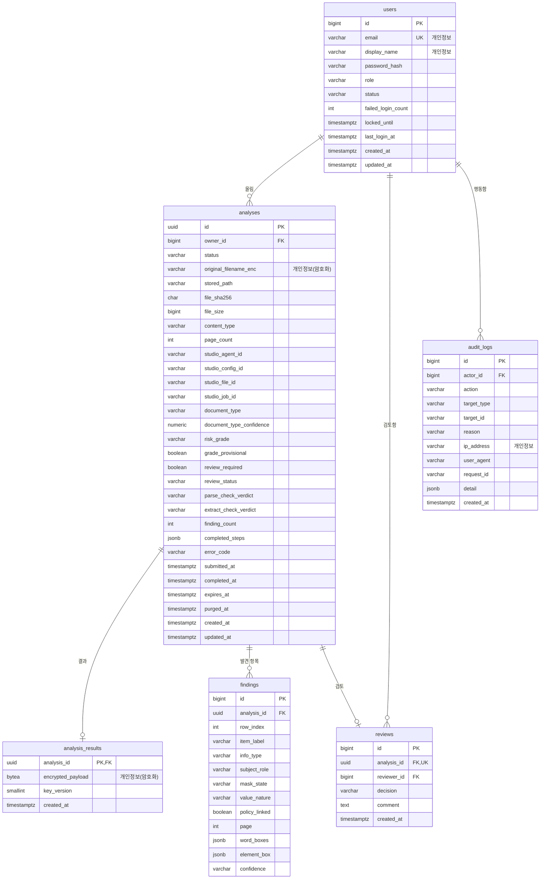

# 데이터베이스 구성

- 프로젝트명: IM-BANK
- 최종 수정일: 2026-11-09
- 상태: draft

PostgreSQL 16을 쓰고, 스키마는 Flyway(`server/src/main/resources/db/migration`)로 관리합니다. 용어는 [도메인 정의](./DOMAIN.md), 암호화와 보관 기간은 [보안](./SECURITY.md)을 따릅니다.

## 1. 설계 원칙

- **원문값은 평문 컬럼에 두지 않습니다.** 발견 항목의 원문값, 원문 근거, 보고서 본문, Studio 원본 응답은 모두 `analysis_results.encrypted_payload` 한 곳에 AES-256-GCM으로 암호화해 둡니다.
- 검색과 목록에 필요한 값(등급, 정보 유형, 가림 상태 등)만 평문 컬럼으로 둡니다. 이 값들만으로는 개인을 알아볼 수 없습니다.
- 원본 파일은 DB가 아니라 파일 저장소(`APP_STORAGE_DIR`)에 암호화해 두고, DB에는 경로와 해시만 둡니다.
- 보관 기간이 지나도 자동으로 지우지 않고 관리자에게 삭제를 권고합니다. 원본 파일과 `analysis_results`, `findings`는 관리자나 소유자가 지울 때까지 남습니다.

## 2. ERD



## 3. 테이블별 스키마

표의 "PII" 열은 개인정보 포함 여부입니다. **암호**는 암호화해서 저장한다는 뜻입니다.

### `users`

| 컬럼 | 타입 | 제약 | PII | 설명 |
|---|---|---|---|---|
| `id` | `bigint` | PK, identity | | |
| `email` | `varchar(254)` | NOT NULL, UNIQUE (소문자로 저장) | 예 | 로그인 ID |
| `display_name` | `varchar(50)` | NOT NULL | 예 | 화면 표시 이름 |
| `password_hash` | `varchar(100)` | NOT NULL | | BCrypt (cost 12) |
| `role` | `varchar(20)` | NOT NULL, CHECK IN (`INSPECTOR`, `REVIEWER`, `ADMIN`) | | |
| `status` | `varchar(20)` | NOT NULL, CHECK IN (`ACTIVE`, `LOCKED`, `DISABLED`) | | |
| `failed_login_count` | `int` | NOT NULL, 기본 0 | | |
| `locked_until` | `timestamptz` | NULL | | 로그인 실패 잠금 해제 시각 |
| `last_login_at` | `timestamptz` | NULL | | |
| `created_at`, `updated_at` | `timestamptz` | NOT NULL | | |

### `analyses`

| 컬럼 | 타입 | 제약 | PII | 설명 |
|---|---|---|---|---|
| `id` | `uuid` | PK | | URL에 쓰므로 추측하기 어려운 값 |
| `owner_id` | `bigint` | FK → `users.id`, NOT NULL | | 올린 사람 |
| `status` | `varchar(20)` | NOT NULL, CHECK (상태 목록은 [도메인](./DOMAIN.md) 5장) | | |
| `original_filename_enc` | `varchar(512)` | NOT NULL | 암호 | 파일 이름에 고객 이름이 들어갈 수 있어 암호화 |
| `stored_path` | `varchar(255)` | NULL (삭제 후 NULL) | | 저장소 안의 무작위 파일 이름 |
| `file_sha256` | `char(64)` | NOT NULL | | 같은 파일 재업로드 확인용 |
| `file_size` | `bigint` | NOT NULL | | |
| `content_type` | `varchar(50)` | NOT NULL | | `application/pdf`, `image/jpeg`, `image/png` |
| `page_count` | `int` | NULL | | Parse 결과에서 채움 |
| `studio_agent_id`, `studio_config_id` | `varchar(64)` | NOT NULL | | 이 분석에 사용한 워크플로와 설정 버전 |
| `studio_file_id`, `studio_job_id` | `varchar(64)` | NULL | | Studio 쪽 ID |
| `document_type` | `varchar(50)` | NULL | | Classify 결과 (예: 예금) |
| `document_type_confidence` | `numeric(4,3)` | NULL | | |
| `risk_grade` | `varchar(10)` | NULL, CHECK IN (`HIGH`, `MEDIUM`, `LOW`, `NONE`, `UNKNOWN`, `UNDECIDED`) | | `UNDECIDED`는 보고서의 미확정, `UNKNOWN`은 서버 해석 실패(V2 마이그레이션). `NONE`은 v2.5 기록용 |
| `grade_provisional` | `boolean` | NOT NULL, 기본 false | | 잠정 등급. v3.2에서 폐기되어 v2.5 기록에만 true 가 있음 |
| `review_required` | `boolean` | NULL | | Studio 판정의 사람 검토 여부 |
| `review_status` | `varchar(20)` | NOT NULL, CHECK IN (`NOT_REQUIRED`, `PENDING`, `CONFIRMED`, `DISPUTED`) | | |
| `parse_check_verdict`, `extract_check_verdict` | `varchar(10)` | NULL | | `green`, `yellow`, `red` |
| `finding_count` | `int` | NULL | | |
| `completed_steps` | `jsonb` | NOT NULL, 기본 `[]` | | 끝난 단계 이름 목록(진행 표시용) |
| `error_code` | `varchar(40)` | NULL | | `STUDIO_TIMEOUT`, `STUDIO_JOB_FAILED`, `STUDIO_UPLOAD_FAILED` 등. 오류 메시지 원문은 저장하지 않음 |
| `submitted_at`, `completed_at` | `timestamptz` | NULL | | |
| `expires_at` | `timestamptz` | NOT NULL | | `created_at + APP_RETENTION_HOURS`. 이 시각이 지나면 삭제를 권고 |
| `purged_at` | `timestamptz` | NULL | | 원본·상세 결과 삭제 시각 |
| `created_at`, `updated_at` | `timestamptz` | NOT NULL | | |

### `analysis_results`

| 컬럼 | 타입 | 제약 | PII | 설명 |
|---|---|---|---|---|
| `analysis_id` | `uuid` | PK, FK → `analyses.id` ON DELETE CASCADE | | |
| `encrypted_payload` | `bytea` | NOT NULL | 암호 | 아래 JSON을 AES-256-GCM으로 암호화 (12바이트 IV + 암호문 + 태그) |
| `key_version` | `smallint` | NOT NULL | | 키 교체 대비 |
| `created_at` | `timestamptz` | NOT NULL | | |

암호화 전 JSON 구조:

```json
{
  "report": { "raw": "보고서 본문", "sections": { "요약": "...", "판정 근거": "..." } },
  "findings": [ { "rowIndex": 0, "원문값": "...", "원문 근거": "...", "정보주체 식별근거": "...", "검토 사유": "...", "잔존 정보": "..." } ],
  "citations": [ { "index": 1, "sourceRef": "민감정보 발견내역[0].원문값", "page": 1, "wordBoxes": [[{"x": 0.21, "y": 0.19}]] } ],
  "steps": [ { "name": "step_1_parse", "cacheHit": true } ],
  "gradeRoute": "RULE"
}
```

`잔존 정보`와 `gradeRoute`는 v4부터 있어 이전 결과에는 없습니다. 잔존 정보는 AI가 쓴 자유 문장이어서 값이 섞일 수 있으므로 평문 컬럼에 두지 않습니다. 화면에는 일부 가린 항목에서 숫자 세 개 이상이 이어지지 않은 경우에만 보여 줍니다.

Studio 원본 응답 전체는 저장하지 않습니다. 디버깅이 필요하면 `APP_KEEP_RAW_RESPONSE=true`일 때만 위 JSON에 `raw`를 추가합니다(로컬 전용).

### `findings`

원문값 없이 화면 목록과 문서 위 상자에 필요한 값만 둡니다. 원문값은 `rowIndex`로 `encrypted_payload.findings`와 연결합니다.

| 컬럼 | 타입 | 제약 | PII | 설명 |
|---|---|---|---|---|
| `id` | `bigint` | PK | | |
| `analysis_id` | `uuid` | FK, ON DELETE CASCADE | | |
| `row_index` | `int` | NOT NULL, UNIQUE(`analysis_id`, `row_index`) | | Studio 추출 결과의 순서 |
| `item_label` | `varchar(100)` | NOT NULL | | 항목명 (예: 예금주, 계좌번호) |
| `info_type` | `varchar(30)` | NOT NULL | | 정보 유형 (예: 이름, 주민등록번호) |
| `subject_role` | `varchar(30)` | NOT NULL | | 정보주체 역할 (예: 신청인, 거래상대방) |
| `mask_state` | `varchar(20)` | NOT NULL | | 미마스킹, 부분마스킹, 전체마스킹 |
| `value_nature` | `varchar(20)` | NULL | | 개인별 사실, 공통조건, 예시·합성 등 |
| `policy_linked` | `boolean` | NOT NULL | | Match 단계에서 정책과 연결되었는지 |
| `page` | `int` | NULL | | |
| `word_boxes` | `jsonb` | NULL | | 값 자체의 상자들 (`word_coordinates`, 상대 좌표) |
| `element_box` | `jsonb` | NULL | | 값이 들어 있는 요소의 상자 (`coordinates`) |
| `confidence` | `varchar(10)` | NULL | | `high`, `low` |

> ⚠️ 가정: 좌표만으로는 개인을 알아볼 수 없으므로 평문으로 둡니다. 다만 원본 파일과 함께 있으면 값의 위치를 알려 주므로, 원본과 같은 시점에 삭제합니다.

### `reviews`

| 컬럼 | 타입 | 제약 | PII | 설명 |
|---|---|---|---|---|
| `id` | `bigint` | PK | | |
| `analysis_id` | `uuid` | FK, UNIQUE | | 분석 하나에 검토 하나 |
| `reviewer_id` | `bigint` | FK → `users.id`, NOT NULL | | |
| `decision` | `varchar(20)` | NOT NULL, CHECK IN (`CONFIRMED`, `DISPUTED`) | | |
| `comment` | `text` | `DISPUTED`이면 NOT NULL (애플리케이션 검증), 최대 1,000자 | 주의 | 검토 의견에 원문값을 적지 말라고 화면에서 안내 |
| `created_at` | `timestamptz` | NOT NULL | | |

### `audit_logs`

| 컬럼 | 타입 | 제약 | PII | 설명 |
|---|---|---|---|---|
| `id` | `bigint` | PK | | |
| `actor_id` | `bigint` | FK → `users.id`, NULL(로그인 실패 등) | | |
| `action` | `varchar(40)` | NOT NULL | | 목록은 [보안](./SECURITY.md) 7장 |
| `target_type`, `target_id` | `varchar(30)`, `varchar(64)` | NULL | | 예: `ANALYSIS`, 분석 ID |
| `reason` | `varchar(300)` | NULL | | 원문 열람 사유 등 |
| `ip_address` | `varchar(45)` | NULL | 예 | |
| `user_agent` | `varchar(300)` | NULL | | |
| `request_id` | `varchar(36)` | NULL | | |
| `detail` | `jsonb` | NULL | | 원문값을 넣지 않음 |
| `created_at` | `timestamptz` | NOT NULL | | |

감사 기록은 애플리케이션에서 추가만 하고 수정·삭제하지 않습니다. DB 계정 권한으로도 `UPDATE`, `DELETE`를 막는 방안은 TBD입니다(질문: 로컬 시연에서 DB 계정을 둘로 나눌 만큼 필요한가요?).

## 4. 관계와 제약 조건

- `analyses.owner_id`는 `users`를 참조하며, 사용자를 지우지 않고 `DISABLED`로만 바꿉니다. 그래서 `ON DELETE`는 `RESTRICT`입니다.
- `analysis_results`, `findings`는 분석이 지워지면 함께 지워집니다(`CASCADE`).
- `reviews`는 분석 하나에 최대 하나이고, 분석의 `review_status`가 `PENDING`일 때만 만들 수 있습니다. 만들면 `review_status`를 `CONFIRMED` 또는 `DISPUTED`로 바꿉니다. 두 변경은 한 트랜잭션에서 처리합니다.
- `risk_grade`, `review_required`는 Studio 결과에서만 채웁니다. 검토가 이 값을 바꾸지 않습니다.

## 5. 인덱스 전략

| 인덱스 | 용도 |
|---|---|
| `users(email)` UNIQUE | 로그인 |
| `analyses(owner_id, created_at DESC)` | 내 분석 목록 |
| `analyses(review_status, created_at)` WHERE `review_status = 'PENDING'` | 검토 대기열 |
| `analyses(status)` WHERE `status IN ('UPLOADING', 'QUEUED', 'RUNNING')` | 상태 조회 스케줄러 |
| `analyses(expires_at)` WHERE `purged_at IS NULL` | 삭제 권고 대상 조회 |
| `findings(analysis_id, row_index)` UNIQUE | 결과 조회 |
| `audit_logs(created_at DESC)`, `audit_logs(actor_id, created_at DESC)` | 감사 기록 조회 |

## 6. 마이그레이션 방침

- 파일 이름은 `V{번호}__{설명}.sql`입니다. 예: `V1__init_schema.sql`, `V2__seed_reference.sql`.
- 이미 적용한 마이그레이션 파일은 수정하지 않고, 바꿀 내용은 새 번호로 추가합니다.
- **계정 시드는 마이그레이션에 넣지 않습니다.** 비밀번호가 저장소에 남기 때문입니다. 미리 만드는 계정은 `scripts/seed-accounts`가 무작위 비밀번호로 만듭니다([아키텍처](./ARCHITECTURE.md) 7장).
- 테스트는 Testcontainers의 PostgreSQL 16에서 Flyway 마이그레이션을 그대로 적용해 실행합니다.
- JPA `ddl-auto`는 `validate`로 두어, 엔티티와 스키마가 다르면 서버가 시작되지 않게 합니다.

## 7. 개인정보 포함 컬럼 요약

| 테이블 | 컬럼 | 보호 방법 |
|---|---|---|
| `users` | `email`, `display_name` | 접근 권한 제한, 화면에서 관리자만 전체 목록 조회 |
| `analyses` | `original_filename_enc` | AES-256-GCM |
| `analysis_results` | `encrypted_payload` | AES-256-GCM, 관리자·소유자가 지울 때 삭제 |
| `reviews` | `comment` | 원문값 입력 금지 안내, 길이 제한 |
| `audit_logs` | `ip_address` | 보관 기간 1년 후 삭제 (TBD: [보안](./SECURITY.md) 6장) |
| 파일 저장소 | 원본 파일 | AES-256-GCM, 관리자·소유자가 지울 때 삭제 |
