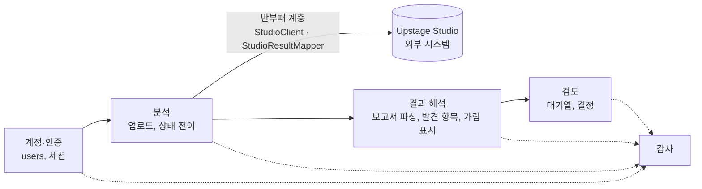
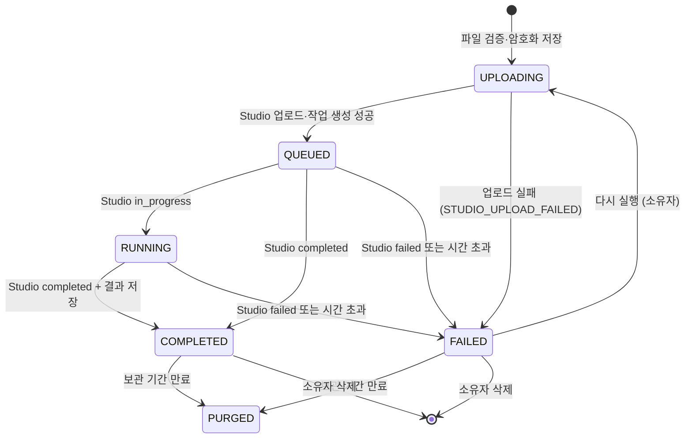
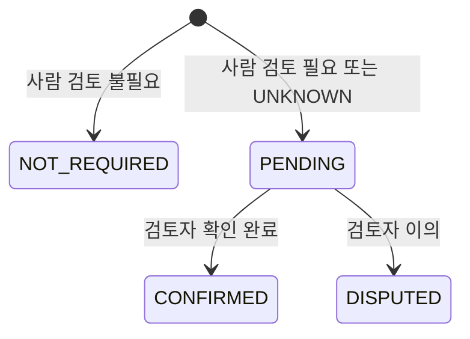

# 도메인 정의

- 프로젝트명: IM-BANK
- 최종 수정일: 2026-11-09
- 상태: draft

판정 기준의 내용과 변경 이유는 워크플로 변경 설명에 있습니다. 이 문서는 웹 서비스가 그 결과를 다룰 때 쓰는 용어와 규칙을 정의합니다.

## 1. 용어 사전 (Ubiquitous Language)

### 서비스 용어

| 용어 | 코드 이름 | 정의 |
|---|---|---|
| 분석 | `Analysis` | 문서 한 건을 올려 Studio 워크플로로 판정받는 단위. 파일 하나에 분석 하나 |
| 분석 결과 | `AnalysisResult` | 분석이 끝난 뒤의 보고서, 발견 항목, 인용 묶음 |
| 발견 항목 | `Finding` | Studio Extract가 찾아낸 보호 대상 값 한 행 (Studio의 `민감정보 발견내역[]` 한 항목) |
| 원문값 | `rawValue` | 문서에 적힌 값 그대로. 암호화 저장, 열람은 감사 대상 |
| 표시값 | `displayValue` | 화면에 기본으로 보여 주는 가린 값 (4장 규칙) |
| 원문 보기 | `Reveal` | 권한 있는 사용자가 사유를 적고 원문값을 보는 행동 |
| 인용 | `Citation` | 보고서 문장의 【†n】 표시와 그 근거가 된 발견 항목·좌표의 연결 |
| 상자 | `Box` | 문서 위에 그리는 사각형. 꼭짓점 4개의 상대 좌표(0~1) |
| 검토 | `Review` | 검토자가 사람 검토가 필요한 분석을 확인하고 남기는 결정 |
| 감사 기록 | `AuditLog` | 누가, 언제, 무엇을 했는지 남기는 기록 |

### 판정 용어 (Studio 워크플로에서 옴)

| 용어 | 코드 값 | 정의 |
|---|---|---|
| 위험 등급 | `RiskGrade`: `HIGH`(상), `MEDIUM`(중), `LOW`(하), `UNDECIDED`(미확정), `UNKNOWN`(판정 확인 필요) | 문서 전체의 위험 수준. v3.2 보고서 표기는 상·중·하·미확정임. 미확정은 네 번째 위험 등급이 아니며 `UNDECIDED`로 저장함. `UNKNOWN`은 서버가 보고서를 해석하지 못한 경우에만 씀. `NONE`(노출 없음)은 v3.2에서 폐기되어 v2.5 기록을 읽을 때만 씀 |
| 잠정 | `provisional` | v3.2에서 폐기됨. v2.5 기록을 읽을 때만 씀 |
| 사람 검토 | `reviewRequired` | 자동 판정만으로 확정할 수 없어 사람이 확인해야 함. 등급과 별개 |
| 정보 유형 | `infoType` | 이름, 주민등록번호, 여권번호, 계좌번호, 카드번호, 전화번호, 이메일, 주소, 예금잔액, 거래내역, 소득, 재산, 채무, 대출신청금액, 건강정보, 기타보호정보, 판별불가 |
| 정보주체 역할 | `subjectRole` | 값의 주인이 문서에서 맡은 역할. 신청인, 예금주, 보증인, 피보험자, 거래상대방, 수익자, 가입자, 동행인, 판별불가 등 |
| 가림 상태 | `maskState` | 미마스킹(가림 없음), 부분마스킹(일부 가림), 전체마스킹(전체 가림) |
| 값 성격 | `valueNature` | 금액이 실제 금액(실제값)인지, 한도 같은 설정값인지 구분 |
| 기준 | `Criterion` | 등급을 정하는 규칙. 보고서에는 「」 이름으로 나옴 (아래 표) |
| 점검 판정 | `CheckVerdict`: `green`, `yellow`, `red` | 원문 인식 점검과 추출 결과 점검 노드의 결과 |
| 문서 종류 | `documentType` | Classify 결과 (예: 예금, 대출) |

### 기준 이름과 등급

| 내부 코드 | 보고서 표기 | 등급 |
|---|---|---|
| R1 | 「고유식별번호 노출」 (일부 가림 포함) | 상 |
| R5 | 「건강정보 노출」 | 상 |
| R2 | 「본인 금융정보 결합 노출」 | 상 |
| R3 | 「식별·연락·계좌 정보 노출」 | 중 |
| R4 | 「그 밖의 개인 보호정보 노출」 | 중 |
| R0 | 「규칙상 노출 미발견」 | 하 |

기준표는 최종본 v3.2(정책판본 2026-11-09.1)를 따릅니다. R1P, R2T, R2Q는 폐기되었습니다.

화면에는 보고서 표기만 씁니다. 내부 코드는 서버 로그와 테스트에서만 씁니다.

## 2. 핵심 엔티티와 생명주기

| 엔티티 | 생성 | 변경 | 종료 |
|---|---|---|---|
| 사용자 | 회원가입 또는 시드 스크립트 | 역할 변경(관리자), 잠금·해제 | 비활성화 (삭제하지 않음) |
| 분석 | 업로드 | 상태 전이(5장), Studio 결과 반영, 검토 상태 변경 | 보관 기간 후 정리(`PURGED`) 또는 소유자 삭제 |
| 분석 결과 | Studio 작업 완료 시 한 번 | 변경 없음 | 보관 기간 후 삭제 |
| 발견 항목 | 분석 결과와 함께 | 변경 없음 | 분석 결과와 함께 삭제 |
| 검토 | 검토자가 결정 | 변경 없음 (한 번만 기록) | 분석이 지워지면 함께 삭제 |
| 감사 기록 | 행동이 일어날 때 | 변경 없음 | 보관 기간(1년, TBD) 후 삭제 |

## 3. 바운디드 컨텍스트

| 컨텍스트 | 책임 | 다른 컨텍스트와의 관계 |
|---|---|---|
| 계정·인증 | 사용자, 역할, 로그인 | 다른 컨텍스트에 현재 사용자와 역할을 제공 |
| 분석 | 파일 검증·저장, Studio 작업 관리, 상태 전이 | Studio 응답 형식은 `studio` 패키지에서만 다루고, 안쪽에는 서비스 용어로 바꿔 넘김 |
| 결과 해석 | 보고서 문단·등급 읽기, 발견 항목·좌표·인용 정리, 표시값 만들기 | 판정을 새로 내리지 않음 |
| 검토 | 검토 대기열, 검토 결정 | 분석의 `review_status`만 바꿈 |
| 감사 | 기록 추가·조회 | 모든 컨텍스트가 기록을 남김 |

## 4. 비즈니스 규칙과 불변 조건

### 판정

- **BR01:** 위험 등급과 사람 검토 여부는 Studio 보고서에서만 정합니다. 서버와 검토자는 이 값을 바꾸지 않습니다.
- **BR02:** 보고서의 `위험 등급` 줄이나 `사람 검토` 줄을 읽지 못하면 `risk_grade = UNKNOWN`, `review_required = true`로 둡니다. 보고서 등급이 `미확정`이면 `risk_grade = UNDECIDED`로 저장하고 사람 검토 여부는 보고서를 따릅니다.
- **BR03:** `review_required = true`이면 `review_status = PENDING`, 아니면 `NOT_REQUIRED`로 시작합니다.
- **BR04:** 분석마다 사용한 Agent ID와 Config ID를 기록합니다. 최종본 v3.2의 Config ID는 `5`이고 `UPSTAGE_CONFIG_ID`로 지정합니다. 코드 기본값은 `2`(v2.5)로 남아 있습니다.

### 업로드

- **BR05:** 분석 하나에는 파일 하나만 올립니다. 허용 형식은 PDF, JPG, PNG이고, 크기와 쪽수는 제한하지 않습니다(2026-11-08 사용자 결정). 파일 형식은 확장자가 아니라 파일 앞부분의 시그니처로 확인합니다.
- **BR06:** 한 사용자가 진행할 수 있는 분석(`UPLOADING`, `QUEUED`, `RUNNING`)의 건수는 제한하지 않습니다(2026-11-08 사용자 결정).
- **BR07:** Studio 작업이 끝나면(완료·실패 모두) Studio에 올린 파일을 지웁니다.

### 표시와 열람

- **BR08:** 화면은 기본으로 표시값만 보여 줍니다. 원문 보기는 사유 입력이 필수이고, 감사 기록을 남긴 뒤에만 원문값을 돌려줍니다.
- **BR09:** 표시값 규칙은 아래와 같습니다. Studio가 이미 일부 가림·전체 가림으로 판정한 값은 원문 그대로(이미 가려진 상태로) 보여 줍니다.

| 정보 유형 | 표시값 예 |
|---|---|
| 이름 | 첫 글자만: `이**` |
| 주민등록번호, 외국인등록번호 | 앞 6자리: `900101-*******` |
| 여권번호, 운전면허번호 | 앞 2자리: `M7*******` |
| 계좌번호, 카드번호 | 마지막 4자리: `****-****-2846` |
| 전화번호 | 마지막 4자리: `010-****-1234` |
| 이메일 | 아이디 앞 2자리: `ab***@example.com` |
| 주소 | 시·구까지: `대구광역시 수성구 ***` |
| 금액(잔액, 거래내역, 소득 등) | `***,***원` |
| 건강정보, 기타 | `(가림)` |

- **BR10:** 문서 뷰어는 기본으로 발견 위치에 불투명한 가림 상자를 그립니다. "원문 보기"를 켜면 상자를 테두리만 남깁니다. 이 전환도 원문 보기와 같은 감사 대상입니다.
- **BR11:** 관리자는 점검 담당자·검토자의 기능을 모두 쓸 수 있고, 모든 사용자의 분석(원본 파일, 발견 항목, 보고서, 파일 이름)을 보고 지울 수 있습니다. 다른 사람 문서의 원본 열람, 원문 보기, 삭제는 감사 기록에 남습니다. (2026-11-08 사용자 결정으로 "볼 수 없음"에서 변경)

### 검토

- **BR12:** 검토는 `review_status = PENDING`인 분석에만, 검토자만 남길 수 있습니다. 한 분석에 한 번만 기록합니다.
- **BR13:** 검토자는 자기가 올린 분석을 검토할 수 없습니다.
- **BR14:** `DISPUTED`(이의)는 사유가 필수입니다.

### 보관

- **BR15:** 분석의 `expires_at`이 지나면 원본 파일, 분석 결과, 발견 항목을 지우고 상태를 `PURGED`로 바꿉니다. 등급, 검토 상태, 시각 같은 요약은 남깁니다.
- **BR16:** 소유자는 언제든 자기 분석을 지울 수 있습니다. 검토가 끝나지 않은(`PENDING`) 분석도 지울 수 있으며, 지우면 대기열에서 빠집니다.

## 5. 상태 전이

### 분석 상태 (`analyses.status`)

| 상태 | 의미 |
|---|---|
| `UPLOADING` | 서버에 저장했고 Studio에 올리는 중 |
| `QUEUED` | Studio 작업이 생성되어 대기 중 |
| `RUNNING` | Studio가 처리 중 |
| `COMPLETED` | 결과를 해석해 저장함 (`UNKNOWN` 등급도 여기에 포함) |
| `FAILED` | 실패. `error_code`에 사유 |
| `PURGED` | 원본과 상세 결과를 삭제하고 요약만 남음 |

### 검토 상태 (`analyses.review_status`)

검토 상태는 분석이 `COMPLETED`가 될 때 정해집니다. 그 전에는 `NOT_REQUIRED`를 기본값으로 두되, 화면은 분석이 완료되기 전에는 검토 상태를 보여 주지 않습니다.

### 사용자 상태 (`users.status`)

| 전이 | 조건 |
|---|---|
| `ACTIVE` → `LOCKED` | 로그인 5회 연속 실패 (15분 뒤 자동 해제) 또는 관리자가 잠금 |
| `LOCKED` → `ACTIVE` | 잠금 시간 경과 또는 관리자 해제 |
| `ACTIVE`·`LOCKED` → `DISABLED` | 관리자가 비활성화. 로그인 불가, 세션 즉시 만료 |
| `DISABLED` → `ACTIVE` | 관리자가 다시 활성화 |
