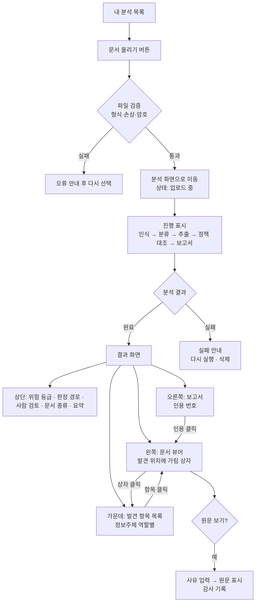
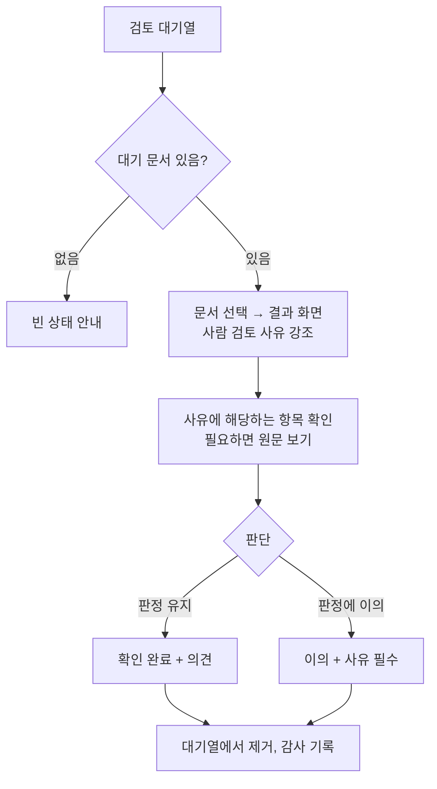
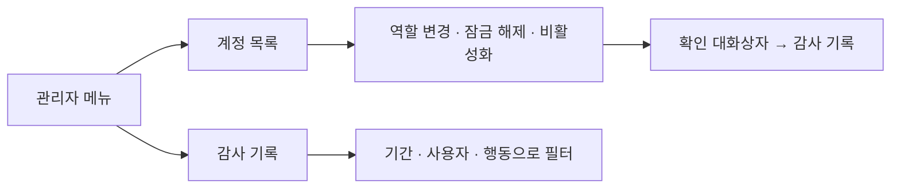
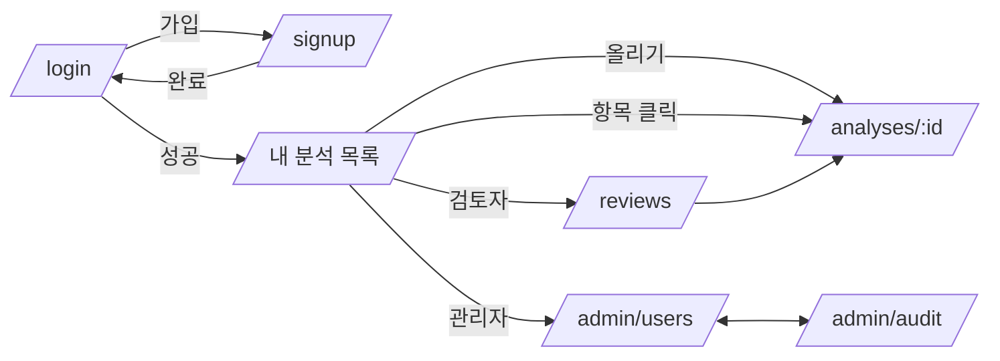
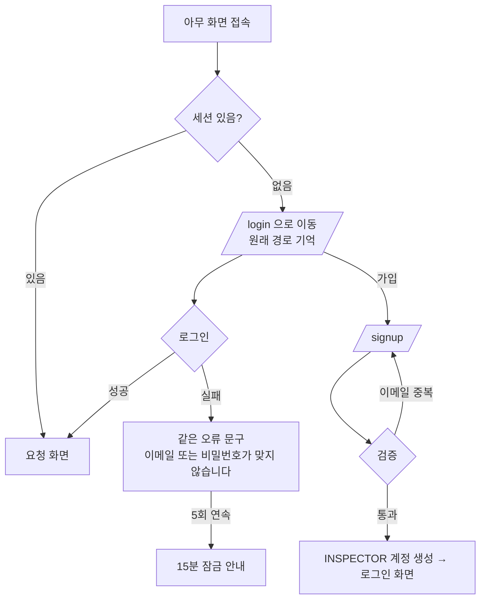

# 유저 플로우

- 프로젝트명: IM-BANK
- 최종 수정일: 2026-11-09
- 상태: draft

기능 ID(F01 등)는 [PRD](./PRD.md) 4장, 역할별 권한은 [보안](./SECURITY.md) 1장을 따릅니다.

## 1. 핵심 사용자 여정

### 1-1. 점검 담당자: 문서를 올리고 결과 확인 (F02~F07)

- 진행 표시는 Studio 작업 상태(`queued`, `in_progress`)를 기준으로 합니다. 진행 중 응답에 끝난 단계가 들어 있으면 그 단계까지 완료로 표시하고, 없으면 경과 시간과 예상 단계 순서만 보여 줍니다. ([PRD](./PRD.md) 9장의 TBD)
- 사람 검토가 필요한 문서는 결과 화면 상단에 "검토 대기 중" 표시가 붙고, 검토자가 기록하면 검토 결과로 바뀝니다.
- 결과 화면의 분석 보고서 칸에서 `.md`(보고서)와 `.json`(판정·발견 항목·근거 위치), PDF 원본이면 가린 PDF를 내려받을 수 있습니다. 어느 파일에도 가리지 않은 원문값은 들어가지 않습니다. 가린 PDF를 받으면 가리지 못한 건수와 공유 전 직접 확인 안내를 보여 줍니다.

### 1-2. 검토자: 검토 대기 문서 처리 (F08)

- 검토자는 Studio 판정을 바꾸지 않습니다. 결과 화면에는 Studio 판정과 검토자 의견이 따로 표시됩니다.

### 1-3. 관리자: 계정과 감사 기록 (F09, F10)

- 관리자는 점검 담당자·검토자의 기능을 모두 쓸 수 있습니다. 분석 현황에서 모든 사용자의 문서를 열어 보고 지울 수 있으며, 다른 사람 문서의 원본 열람·원문 보기·삭제는 감사 기록에 남습니다.

### 1-4. 심사위원 시연 (F12)

1. 미리 만든 점검 담당자 계정으로 로그인합니다.
2. 평가 문서 한 건(set02)을 올려 진행 표시와 결과 화면을 보여 줍니다.
3. 판정 근거의 인용 번호를 눌러 문서 위치로 이동하는 기능을 보여 줍니다.
4. 사람 검토 문서(set09)를 검토자 계정으로 처리합니다.
5. 시연 정확도 화면에서 10건 결과가 정답과 일치함을 보여 줍니다.

시연 중 네트워크 문제에 대비해, 10건은 시연 전에 미리 실행해 두고 결과 화면을 바로 열 수 있게 합니다.

## 2. 화면 목록과 전환 관계

| 경로 | 화면 | 접근 | 주요 요소 |
|---|---|---|---|
| `/login` | 로그인 | 비로그인 | 이메일, 비밀번호, 가입 링크 |
| `/signup` | 회원가입 | 비로그인 | 이름, 이메일, 비밀번호(규칙 안내), 개인정보 처리 안내 동의 |
| `/` | 메인화면 | 로그인 | 역할별 바로가기 타일, 최근 분석, 현황, 이용 안내 |
| `/analyses` | 내 분석 목록 | 점검 담당자, 검토자, 관리자 | 문서 올리기 버튼, 목록(올린 시각, 상태, 등급, 검토 상태) |
| `/analyses/:id` | 분석 화면 | 소유자, 검토자, 관리자 | 진행 중이면 진행 표시, 완료면 결과 화면(세 영역) |
| `/reviews` | 검토 대기열 | 검토자, 관리자 | 대기 문서 목록, 사람 검토 사유 |
| `/admin/users` | 계정 관리 | 관리자 | 계정 목록, 역할·상태 변경 |
| `/admin/audit` | 감사 기록 | 관리자 | 필터, 기록 목록 |
| `/demo/accuracy` | 시연 정확도 | 숨김 (`web/src/lib/features.ts`의 `SHOW_ACCURACY`) | 10건 결과와 정답 비교 표 (P1) |
| `/admin/analyses` | 분석 현황 | 관리자 | 모든 사용자의 분석 목록, 열기, 삭제 |
| `/403`, `/404` | 오류 화면 | 모두 | 이전 화면으로, 목록으로 |

- 상단 메뉴는 역할에 따라 달라집니다. 점검 담당자는 "내 분석", 검토자는 "내 분석·검토 대기열", 관리자는 "내 분석·검토 대기열·분석 현황·계정 관리·감사 기록"을 봅니다.
- 결과 화면은 화면 너비가 1280px 이상일 때 세 영역을 나란히 놓고, 그보다 좁으면 문서 뷰어 위에 탭(발견 항목 / 보고서)을 둡니다.

## 3. 인증과 온보딩 흐름

- 가입하면 항상 점검 담당자(`INSPECTOR`)가 됩니다. 검토자와 관리자는 스크립트로 미리 만든 계정이거나, 관리자가 역할을 바꿔 준 계정입니다.
- 처음 로그인하면 내 분석 목록이 비어 있으므로, 빈 상태 안내에 "문서 올리기"와 "평가 문서로 시험하기" 안내를 보여 줍니다.
- 세션이 만료된 상태에서 API가 401을 돌려주면, 화면은 로그인으로 이동하고 원래 경로로 돌아옵니다.

## 4. 예외 상황 처리 흐름

| 상황 | 화면 처리 |
|---|---|
| 지원하지 않는 형식, 빈 파일 | 업로드 전에 막고 사유를 표시합니다. 서버도 같은 검증을 합니다. |
| Studio 작업 실패, 시간 초과 | 분석 화면에 실패 사유 코드와 "다시 실행", "삭제" 버튼을 보여 줍니다. |
| 보고서 해석 실패 (`UNKNOWN`) | 등급 자리에 "판정 확인 필요"를 표시하고 검토 대기열에 넣습니다. |
| 등급 미확정 (`UNDECIDED`) | 등급 자리에 "미확정"을 표시하고, 자동 점검으로 등급을 확정할 수 없다는 안내와 사람 검토 사유를 보여 줍니다. |
| 점검 단계 red | Studio 판정을 그대로 보여 주고, 사람 검토 사유에 원문 인식 점검 결과를 적습니다. "잠정" 표시는 v3.2에서 폐기되었고 v2.5 기록에만 나타납니다. |
| 발견 항목 없음 | 문서 뷰어에 상자 없이 표시하고, 항목 목록에 "보호 대상이 드러난 항목이 없습니다"를 표시합니다. |
| 좌표가 없는 항목 | 목록에는 보이되 "문서 위치 정보 없음"으로 표시하고, 클릭해도 뷰어를 움직이지 않습니다. |
| 내 분석 목록이 비어 있음 | 빈 상태 안내와 문서 올리기 버튼 |
| 검토 대기열이 비어 있음 | "검토할 문서가 없습니다." |
| 다른 사람의 분석에 접근 | 서버는 존재 여부를 알리지 않도록 404를 돌려주고, 화면은 404 화면을 보여 줍니다. |
| 역할에 없는 메뉴로 직접 이동 | 403 화면 |
| 보관 기간(기본 7일)이 지남 | 문서는 그대로 열립니다. 관리자의 분석 현황에 권고 건수와 문서별 "삭제 권고" 표시가 나오고, 관리자 메인화면에도 건수가 나옵니다. 관리자가 확인한 뒤 지웁니다. |
| 이전 버전의 정리 작업으로 원본이 삭제됨 (`PURGED`) | 등급·상태 같은 요약만 보여 주고 "보관 기간이 지나 원본과 상세 결과를 삭제했습니다"를 표시합니다. |
| 세션 만료 | 로그인 화면으로 이동, 로그인 후 원래 화면으로 복귀 |
| 서버 오류 | "잠시 후 다시 시도해 주세요"와 요청 ID를 표시합니다. 요청 ID로 서버 로그를 찾습니다. |
